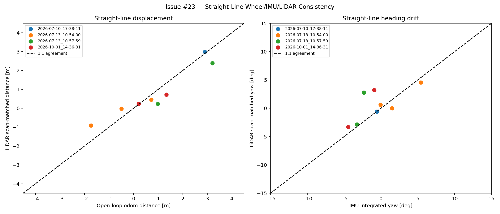
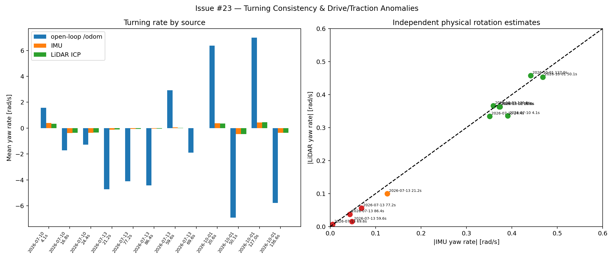
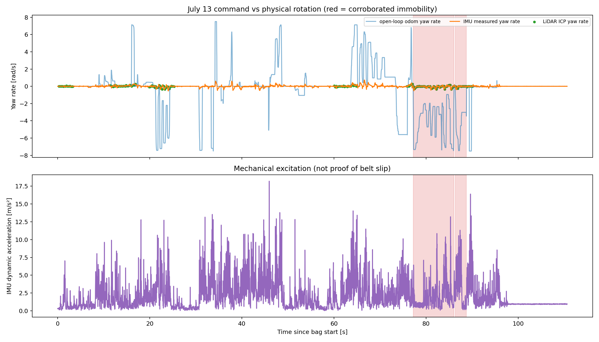

# Issue #23: Navigation Sensor Consistency Validation

## Scope and conclusion

This investigation compares recorded wheel-command odometry, raw IMU motion,
and LiDAR scan matching without changing robot configuration or operating the
robot.

The current robot does **not** implement sensor fusion. `/odom` is open-loop
integration of commanded motor RPM, the IMU is not consumed by navigation, and
LiDAR is used by Nav2/SLAM rather than fused into odometry. The selected bags
show one healthy straight-line baseline and several large command-versus-motion
disagreements. Zero-seed LiDAR ICP and IMU integration generally agree on
physical yaw during turns, while a seed-ablation check exposes material ICP
sensitivity in one outdoor interval. The command-versus-observed-motion
disagreements are credible, but belt slip is not identified: no motor encoder
feedback was recorded, so track-ground skid, belt slip, motor
stall/protection, and historical command-delivery loss cannot be separated.

## Current system

### Wheel odometry

`wheel_driver_node.py` converts the node's internally requested motor RPM to
left/right linear speed and integrates differential-drive motion:

- `v_left/right = rpm * meters_per_motor_turn / 60`
- `v = (v_right + v_left) / 2`
- `yaw_rate = (v_right - v_left) / wheel_separation`

The stack observed during the original issue investigation used
`meters_per_motor_turn: 0.084 m` and `wheel_separation: 0.40 m`. The integration
branch now preserves the newer 16/52 drivetrain configuration:
`meters_per_motor_turn = (16/52) * 0.420 = 0.129230769 m`. That calculated value
still requires an onsite travel measurement. Despite the variable name
`_actual_*`, these values
are command/ramp state sent to the motor controller, not measured wheel
encoder speed. `/odom` and `odom -> base_link` therefore describe predicted
motion. Navigation consumes this `/odom` directly.

The historical `/cmd_vel` conversion was not standard ROS differential-drive
kinematics. It clamped both `linear.x` and `angular.z` to `[-1, 1]`, then
treated them as normalized mixer inputs:

```text
left_rpm  = (linear.x - angular.z) * max_rpm
right_rpm = (linear.x + angular.z) * max_rpm
```

This ignores `wheel_separation` during command conversion and scales a
`1 rad/s` in-place turn to the full configured wheel speed. With the deployed
`max_speed_ms: 1.5` and `wheel_separation: 0.40`, the resulting open-loop yaw
rate is `7.5 rad/s`, not `1 rad/s`. This explains much of the enormous turning
overprediction in historical `/odom`; it is separate from any traction fault.
The issue/integration branch replaces this mixer with SI-unit kinematics and
common-factor wheel-speed saturation. The change is tested offline but has not
been deployed or physically validated.

The prior e-stop resume path cleared its software latch before confirming that
the asynchronous MKS hardware-latch release succeeded. The issue branch now
uses fail-closed `active -> releasing -> clear` state transitions. A release
token rejects stale callbacks; failures and timeouts return to `active`;
velocity commands remain inhibited until confirmation; and stale nonzero
commands are cleared before release. The dashboard and gamepad use a dedicated
resume service rather than overloading stop. Because no safe MKS release
protocol is verified, that service currently returns failure and leaves the
software latch active without issuing recovery register writes.

Mocked tests cover release-state success, failure, timeout, late response,
concurrent e-stop, command inhibition, and malformed replies. Onsite testing
confirmed that `REG_EMERGENCY_STOP=0` is not a supported release: the manual
documents only `F7=1` for stopping. Firmware 1.0.5 added a generic `0x41`
restart, but the installed firmware is unknown and the manual does not
guarantee zero retained motion after restart. Automatic MKS release therefore
remains fail-closed and performs no recovery register writes.

### IMU

The ICM-20948 node publishes `/imu/data_raw`, `/imu/mag`, and
`/imu/temperature` at 50 Hz in `imu_link`. `/imu/data_raw` contains
accelerometer and gyroscope measurements in SI units. It intentionally has no
orientation estimate (`orientation_covariance[0] = -1`). No static
`base_link -> imu_link` transform was found, and no navigation node subscribes
to the IMU.

This analysis integrates only bias-corrected gyroscope Z for short-window yaw.
It does not integrate acceleration into displacement because gravity,
mounting, bias, and drift make that result unreliable.

### LiDAR and navigation

The LiDAR publishes `/scan` in `laser` at 5 Hz. Historical recordings use a
clockwise angle convention; this analysis reflects Y in memory, preserving
every measured range. Point-to-plane SE(2) ICP estimates relative scan motion.

Nav2 uses `/scan` for AMCL and costmap obstacle layers; SLAM Toolbox also uses
it for mapping. Those components may combine scan evidence with `/odom`
internally, but there is no EKF, UKF, `robot_localization`, fused odometry
topic, or fusion output used by the wheel driver/Nav2 odometry input.

The deployed launch file supplies `base_link -> laser` with yaw π, but
supplies no IMU transform. It also instantiates each bag recorder twice. The
recorder's dual-QoS subscriptions explain the observed exact 2:1 duplication
on reliable topics; source-stamp deduplication is required before analysis.
The issue branch removes the duplicate launch declarations.

## Passive live snapshot (2026-11-09)

The running stack came from the separate
`feat/integrate-tft-battery-display` worktree at commit `7c9cb1a`, not from the
current repository worktree. No stack restart or actuator command was issued.
A bounded subscription-only probe observed:

- `/odom`, `/imu/data_raw`, `/imu/mag`, `/tf`, and `/wheel_status` at about
  50 Hz; `/scan` at about 5 Hz; `/mks_bus/status` at 0.5 Hz.
- `/cmd_vel` at about 50 Hz, with all 250 sampled commands equal to zero.
- Increasing source timestamps and expected frames for all sampled stamped
  topics.
- Zero covariance arrays on odometry and IMU angular velocity, unknown IMU
  orientation, and zero LiDAR `time_increment`.
- Valid `odom -> base_link` and `base_link -> laser`; no `map -> odom` and no
  `base_link -> imu_link`.
- One gamepad `/cmd_vel` publisher, but the dashboard reported the controller
  disconnected.
- Two live processes each named `mapping_recorder` and
  `perception_recorder`, matching the duplicate launch declarations.
- The RealSense process existed, but camera image topics had zero publishers
  and both dashboard stream endpoints produced no frames.

The reusable probe is `scripts/check_navigation_sensor_health.py`. It creates
subscriptions and graph queries only; it has no command publisher, service
client, or action client.

The dashboard returned HTTP 200 for `/`, `/api/status`,
`/api/system-health`, and `/api/power-status`. A second read-only check during
this phase again showed wheel RPM at zero, MKS bus connected, wheel motors 1
and 2 cached online, LiDAR scanning with points, and current battery/host
metrics. Wheel, MKS bus, LiDAR, battery, recorder, network, and host metrics
were populated.

The dashboard observed during that live snapshot was not a complete
sensor-health display: it lacked IMU/odometry subscriptions and receipt-time
freshness, and its wheel-speed fallback constants disagreed with the then
deployed configuration. The integration branch adds IMU and odometry payloads,
receipt-time health (`live`, `no_data`, `stale`, `error`, or `disabled`) for
navigation telemetry, and uses the wheel driver's runtime
`meters_per_motor_turn` value with the current 16/52 fallback. Cached MKS
connectivity is still not equivalent to a fresh active controller query.

The issue branch now distinguishes requested/pending release, confirmed
release, and release error in wheel status and the dashboard. The deployed
dashboard does not contain this change: its live `/api/status` still exposes
only `estopped`, so it cannot distinguish a requested release from hardware-
confirmed release. No POST endpoint or dashboard control was exercised.
Browser-based console inspection could not be completed because the local
browser page load stalled; HTTP/API and source-level findings remain valid.

## Data selection and integrity

Four representative recordings were selected rather than processing every
historical bag:

| Recording | Duration | Role |
|---|---:|---|
| `mapping_2026-07-10_17-38-11` | 45.045 s | Indoor healthy baseline with structured scan geometry |
| `mapping_2026-07-13_10-54-00` | 110.641 s | Outdoor command/physical-motion disagreement |
| `mapping_2026-07-13_10-57-59` | 168.463 s | Longer straight and low-rotation cases |
| `mapping_2026-10-01_14-36-31` | 160.349 s | Dense indoor high-command turn saturation baseline |

After deduplication, nominal rates are approximately 50 Hz for `/odom` and
`/imu/data_raw`, and 5 Hz for `/scan`. Frames are consistently `odom`,
`base_link`, `imu_link`, and `laser`. The selected bags contain no `/cmd_vel`;
the recorded `/odom` twist is therefore the only available command proxy.
`/tf_static` is absent from all four selected bags even though its type is
present in metadata. Adjacent scans and samples within a window are
correlated and are not counted as independent experiments.

## Method

1. Deduplicate `/odom`, `/imu/data_raw`, and `/scan` by source header stamp.
2. Estimate gyro-Z bias from samples where open-loop odometry reports both
   linear and angular speed below 0.005 in SI units.
3. Reflect historical scan Y coordinates and run zero-seed point-to-plane ICP
   between adjacent scans. IMU yaw is not supplied to the primary ICP result.
4. Accept registrations with at least 20 inliers and point-to-plane RMSE no
   greater than 0.25 m.
5. Integrate wheel, IMU, and LiDAR estimates over predefined, inspectable
   windows.
6. Re-run with IMU-seeded ICP as a sensitivity check. Most yaw estimates move
   by less than 5°, but the Jul 13 10:57 interval at 59.60–66.66 s changes by
   10.37°, so that interval is not strong independent corroboration.
7. Report final (post-optimization) ICP residual and inlier statistics, rather
   than the initial-guess residual.
8. Shift every segment uniformly by -1.0, -0.5, +0.5, and +1.0 s to expose
   boundary sensitivity without changing segment duration.
9. Compare header stamps with rosbag record time, nearest cross-sensor stamps,
   and zero-seed LiDAR yaw rate with IMU yaw rate over a ±0.3 s lag search.

The configurable diagnostic thresholds are 0.08 rad/s for corroborated low
rotation, 0.25 rad/s for clearly continuous physical turning, and 0.8 rad/s
minimum predicted turn rate. These thresholds separate near-stationary motion
from the observed 0.35–0.47 rad/s healthy physical turns; they are diagnostic
thresholds, not calibrated belt-slip limits.

## Sensor timing

All selected header stamps and rosbag record stamps are compatible ROS/system
epoch clocks. Median record-minus-header delays are 1.8–2.0 ms for IMU,
2.5–3.5 ms for odometry, and 2.9–3.6 ms for LiDAR; p95 values are 3.7–7.8 ms.
Nearest scan stamps are normally within about 9 ms of an IMU sample and 12 ms
of an odometry sample. These transport/stamp differences are small.

Motion alignment exposes a larger ambiguity. The best IMU sample offset
(`IMU(t_lidar_midpoint + lag)`) is -0.130 s for Jul 10, -0.150 s for both
Jul 13 bags, and -0.130 s for Oct 1. Broad near-minimum ranges are:

| Recording | Best lag | Near-minimum range |
|---|---:|---:|
| Jul 10 | -0.130 s | -0.195 to -0.025 s |
| Jul 13 10:54 | -0.150 s | -0.225 to -0.070 s |
| Jul 13 10:57 | -0.150 s | -0.235 to -0.110 s |
| Oct 1 | -0.130 s | -0.250 to -0.110 s |

The LiDAR publishes at 5 Hz with `time_increment=0` and stamps the assembled
scan in the publish timer, so individual beam acquisition time is unknown.
Half one scan period gives an approximate ±0.1 s beam-time uncertainty. This
is consistent with the lag result, but is not enough evidence to apply a
fixed correction. It can alter short-turn totals by several degrees; it
cannot explain hundreds or thousands of degrees of open-loop odometry error.
`/cmd_vel` is absent from every selected bag, so command timing relative to
the recorded streams cannot be reconstructed.

## Straight-line results

| Recording / interval | Open-loop `/odom` | LiDAR ICP | IMU yaw | Interpretation |
|---|---:|---:|---:|---|
| Jul 10, 6.87–14.88 s | 2.8979 m | 2.9859 m | -0.55° | Structured-geometry agreement; distance differs by +3.0% |
| Jul 13 10:54, 0.00–1.95 s | -0.4993 m | -0.0263 m | -0.06° | Little LiDAR translation despite command proxy |
| Jul 13 10:54, 12.86–15.48 s | 0.7167 m | 0.4568 m | +5.41° | Reduced LiDAR translation and heading deviation |
| Jul 13 10:54, 61.46–63.64 s | -1.7387 m | -0.9106 m | +1.49° | Reduced LiDAR translation |
| Jul 13 10:57, 22.38–31.24 s | 3.2082 m | 2.3874 m | -2.31° | Reduced translation; outdoor ICP less constrained |
| Jul 13 10:57, 57.80–59.58 s | 0.9823 m | 0.2329 m | -3.25° | Large displacement disagreement |

Two short October windows were also evaluated, but their 1.00–1.09 s duration,
high vibration, and only six accepted scan pairs make them poor displacement
references. They remain visible in `metrics.json` rather than being treated as
calibration evidence.

The Jul 10 result verifies that the analysis can recover an approximately
3 m straight motion in structured indoor geometry. It does not establish
absolute wheel or LiDAR scale because no independently measured ground-truth
distance is available. The degraded windows establish command-versus-physical
motion disagreement, not its mechanical cause.



## Turning results

Primary LiDAR yaw is now calculated without an IMU seed. Most selected turns
show similar IMU and unseeded-LiDAR yaw, subject to the sensitivity limitations
above:

| Recording / interval | `/odom` yaw | IMU yaw | LiDAR yaw | Interpretation |
|---|---:|---:|---:|---|
| Jul 10, 4.14–5.48 s | +121.32° | +30.01° | +25.77° | Continuous observed rotation; command model overpredicts |
| Jul 10, 16.80–21.00 s | -413.56° | -89.61° | -87.36° | Continuous observed rotation |
| Jul 13 10:54, 21.24–24.32 s | -832.66° | -22.15° | -17.67° | Intermediate observed rotation under command |
| Jul 13 10:54, 77.22–86.08 s | -2084.41° | -35.07° | -28.65° | Low observed physical rotation |
| Jul 13 10:54, 86.36–88.78 s | -615.58° | -5.98° | -5.24° | Near-zero observed rotation |
| Jul 13 10:57, 69.64–78.64 s | -980.69° | -2.76° | +3.75° | Near-zero net rotation |
| Oct 1, 50.14–52.64 s | -990.02° | -67.10° | -64.93° | Smooth observed rotation, not evidence of slip |

The October intervals are important controls: large `/odom` disagreement alone
would produce false slip alarms. IMU and unseeded LiDAR show smooth physical yaw rates
near 0.4–0.5 rad/s while the command-derived model reaches about 7 rad/s.
A single constant correction factor therefore cannot distinguish normal
bounded physical response from a drive-loss event.



The Jul 13 timeline highlights intervals where both physical yaw estimates are
low. Dynamic acceleration indicates mechanical excitation, but is not proof of
belt slip.



### ICP quality and sensitivity

Final ICP residuals support the structured indoor yaw results more strongly
than outdoor translation. Jul 10 has median final RMSE near 0.019 m. Oct 1 is
near 0.011–0.012 m with typically more than 250 inliers. Jul 13 outdoor
windows vary roughly 0.014–0.050 m median RMSE, with p95 residuals reaching
about 0.104 m and lower inlier counts. Passing the permissive 0.25 m gate
does not make outdoor translation ground truth.

The zero-seed result remains primary and independent of IMU initialization.
IMU-seed ablation changes the Jul 13 10:54 turning windows by 4.05° and 4.84°,
and changes Jul 13 10:57 at 59.60–66.66 s by 10.37°. Most indoor windows are
below 1°. The sensitive intervals remain usable as observations but not as
strong independent IMU corroboration.

Boundary shifts show that exact values from several short hand-selected
windows are unstable. Jul 10 at 4.14–5.48 s changes classification under
±0.5/±1.0 s shifts and its LiDAR yaw spans approximately -7.1° to +28.1°.
The first Jul 13 10:54 straight window, the 21.24–24.32 s turn, and both
short Oct 1 straight windows also change classification. In contrast, the
Jul 13 reduced-translation windows at 12.86–15.48, 61.46–63.64, and
22.38–31.24 s, the low-rotation turn at 77.22–86.08 s, both Jul 13 10:57
turns, and all four Oct 1 turns retain their classification. The report
therefore treats stable longer windows as stronger qualitative evidence and
does not overstate exact endpoints.

Gyro bias is small (about -0.00056 to -0.00238 rad/s), but its uncertainty is
not a calibration result. "Stationary" samples are selected from near-zero
open-loop odometry rather than an independent chassis-still detector. Their
robust MAD is about 0.0024–0.0053 rad/s; ordinary standard deviation is
inflated where commanded stillness did not imply physical stillness.

## Belt-slip assessment

**Observation:** multiple windows have predicted wheel motion far above both
IMU and LiDAR motion. IMU and LiDAR generally agree on yaw direction and rate.

**Supported conclusion:** the robot chassis rotated or translated much less
than open-loop `/odom` predicted in those windows. These anomalies can be
detected offline and could support a runtime command-versus-motion monitor.

**Unresolved hypothesis:** belt slip is one plausible cause, but is not
identifiable from these bags. `/odom` is not wheel feedback, no individual
encoder positions/speeds are recorded, `/cmd_vel` is absent, and motor
acknowledgements/current/fault state are not available in the selected data.
Track-ground skid, motor/controller limiting or stall, and historical RS485
command queue loss remain alternative explanations.

## Motor feedback capability

The installed MKS SERVO57D protocol appears to expose the feedback required
for measured wheel odometry. Existing read-only test code documents input
registers `0x30` (signed carry plus 14-bit encoder value), `0x31` (signed
48-bit cumulative encoder), `0x32` (signed measured RPM), `0xF1` (motion
status), and `0x3A` (enable status). Production `mks_bus_node` currently uses
only `0x3A` for connectivity probes and publishes cached online/current
configuration; it does not poll or publish wheel encoder, measured speed,
motion state, or faults. The wheel backend consequently integrates commanded
ramp RPM.

The ODrive driver already implements `encoder.vel_estimate` reads and current
telemetry, but its wheel backend also does not expose velocity to odometry.
This is secondary because the deployed backend is MKS.

Recommended production design:

1. add bounded, low-priority MKS input-register reads through the sole
   `mks_bus_node` owner; never open `/dev/mksbus` from a second node;
2. poll cumulative encoder (`0x31`) and measured RPM (`0x32`) for wheel IDs 1
   and 2 only when the bus is idle, with command traffic always taking
   priority;
3. decode signed values, handle rollover/reset/discontinuity, apply each
   side's direction convention, and timestamp at receipt;
4. publish measured wheel state plus freshness, communication/fault status,
   and use position deltas for odometry only after stationary and marked-floor
   validation;
5. retain commanded RPM separately for command-versus-feedback residuals.

Protocol support is established from repository code, not from a live read in
this phase. Register availability, sign, scale, rollover, maximum safe poll
rate, and behavior while moving still require an onsite non-actuating read
check followed by supervised motion validation.

## Configuration and frame findings

- Wheel distance scale and separation are nominal configuration values, not
  independently calibrated by these recordings.
- The IMU Z sign agrees with corrected LiDAR yaw in the selected windows, but
  the missing `base_link -> imu_link` transform prevents a complete 3D axis
  audit.
- Historical LiDAR handedness requires offline reflection. Reflection does not
  alter range scale.
- `base_link -> laser` yaw π and physical mounting remain separate concerns.
- Duplicate messages must be removed before frequency or integration analysis.
- All selected bags lack recorded static TF messages; reconstructed transforms are not
  independent validation.
- Outdoor scan matching has weaker geometry and is not ground truth. Agreement
  with IMU is strongest evidence for yaw, while outdoor translation estimates
  have higher correspondence uncertainty.

### TF and extrinsic audit

The live TF tree provides `odom -> base_link` and `base_link -> laser`.
`robot_launch.py` and `mapping_bag_launch.py` declare the latter as translation
`(0.0, 0.0, 0.15) m` and RPY `(0, 0, pi)`, with a source comment saying to
adjust it for the mount. No dimensional measurement or calibration provenance
was found. The selected bags contain no `/tf_static`, so they cannot prove the
transform used at recording time. `base_link -> imu_link` is absent entirely.

The LiDAR driver's separate `angle_offset=-90°` parameter and the static yaw
are both coordinate rotations; neither can repair its historical clockwise
`LaserScan` handedness, because handedness requires reflection. A constant
LiDAR yaw error rotates relative translation into the wrong base axes but does
not change relative ICP yaw. An unknown planar sensor offset also makes the
LiDAR optical center translate during chassis rotation by up to
`2*r*sin(|delta_yaw|/2)`, so it can bias turn-window translation. It cannot
explain the extreme yaw-scale error in commanded odometry.

The missing IMU transform prevents proving its x/y/z axes in `base_link`.
Observed gyro-Z and corrected LiDAR yaw have matching sign in selected
segments, but that is only a planar empirical check. Onsite work must measure
LiDAR optical-center x/y/z and index direction, IMU x/y/z and RPY, and the
chassis `base_link` datum; then publish and record the measured static
transforms. No placeholder value should be promoted to calibration.

## Offline verification

- `python3 -m unittest discover -s test`: **108 tests passed**.
- Python syntax checks passed for all modified/new Python implementation and
  analysis files.
- IDE lint diagnostics: no errors in the modified Python files.
- `colcon build --symlink-install`: **3 packages built successfully**. The
  vendored YDLidar SDK emitted existing C++ format-security warnings.
- `git diff --check`: passed.
- The four-bag zero-seed regression completed and regenerated metrics and all
  three plots.
- JavaScript parser validation was not available because Node.js is not
  installed; dashboard JavaScript was source-reviewed only.

## Reproduction

The script reads bags and writes only small report artifacts:

```bash
cd ~/HorseShitBot
source /opt/ros/humble/setup.bash
MPLCONFIGDIR=/tmp/hsb-matplotlib \
  python3 scripts/analyze_sensor_consistency.py \
  --bags-dir /home/hsb/rosbags \
  --output-dir docs/analysis/generated/issue23 \
  --icp-seed zero

# Sensitivity comparison; do not replace the primary artifacts:
python3 scripts/analyze_sensor_consistency.py \
  --bags-dir /home/hsb/rosbags \
  --output-dir /tmp/issue23_imu_seed \
  --icp-seed imu

python3 -m unittest discover -s test -p 'test_sensor_consistency.py'
```

Machine-readable window definitions, counts, rates, measurements, thresholds,
and classifications are in
[`generated/issue23/metrics.json`](generated/issue23/metrics.json).

## Recommended next steps

1. Record `/cmd_vel`, commanded left/right RPM, acknowledged motor RPM, motor
   encoder position, current/fault status, `/odom`, raw IMU, `/scan`, `/tf`,
   and latched `/tf_static` using one recorder subscription per topic.
2. Add and verify `base_link -> imu_link` and physically measure LiDAR/IMU
   mounting orientation.
3. Perform marked-floor straight tests over independently measured distances
   at low and moderate speed.
4. Perform repeated in-place turns with external angle references at several
   command rates to characterize normal bounded physical response.
5. Video the belt and tracks during controlled turn tests so encoder,
   chassis, and belt motion can be distinguished.
6. Calibrate wheel scale and separation only from independent physical
   references; do not tune them to force agreement with SLAM.
7. Evaluate a separate fusion design only after feedback telemetry, frames,
   covariances, timestamps, and sensor failure behavior are validated.
8. Replace zero `LaserScan.time_increment` with acquisition timing supported
   by the device protocol, then repeat lag analysis before applying any
   synchronization correction.
9. Validate the fail-closed MKS release sequence and firmware-specific latch
   clear acknowledgement with an operator present and the robot physically
   secured.
10. Add dashboard receipt ages and explicit live/stale/error/disabled states;
    subscribe to IMU and odometry only for read-only telemetry.

Offline code changes on `fix/issue23-navigation-sensor-validation` also:

- remove the duplicate recorder declarations from `robot_launch.py`;
- convert ROS `Twist` SI values to wheel RPM with differential-drive geometry;
- preserve curvature when wheel-speed saturation is required;
- centralize inverse RPM-to-twist calculations used by odometry;
- require acknowledged, fail-closed emergency-stop release and reject
  velocity during active or pending release;
- show pending, confirmed, and failed release semantics in the dashboard;
- quantify cross-sensor timing, ICP final residuals/seed sensitivity, and
  segment-boundary sensitivity;
- add hardware-independent kinematics, watchdog/state, launch-structure,
  sensor-health, and historical-analysis tests.

Issue #23 remains partially complete: offline inconsistency is verified and
detectable, but functioning sensor fusion, measured wheel odometry,
belt-slip identification, physical emergency-stop behavior, and supervised
straight/turn acceptance tests are not verified.
