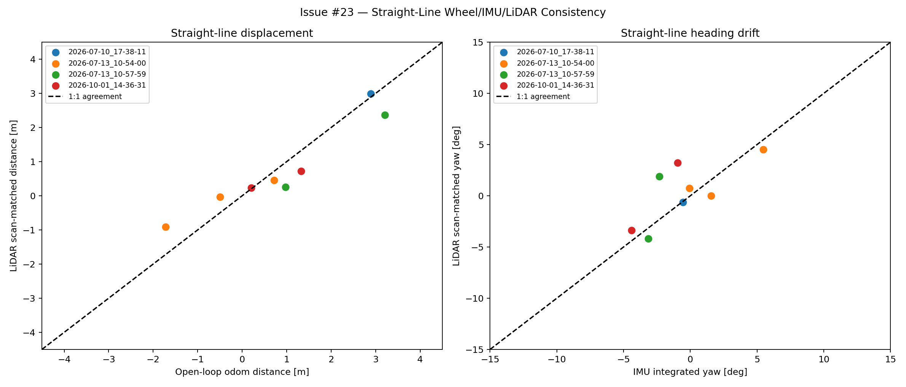
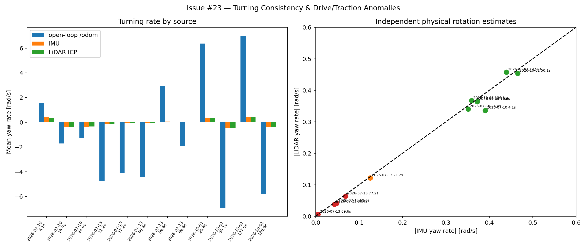
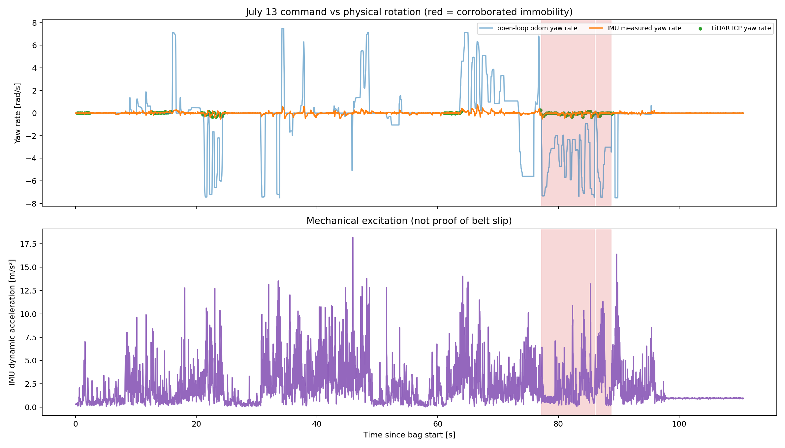

# Issue #23: Navigation Sensor Consistency Validation

## Scope and conclusion

This investigation compares recorded wheel-command odometry, raw IMU motion,
and LiDAR scan matching without changing robot configuration or operating the
robot.

The current robot does **not** implement sensor fusion. `/odom` is open-loop
integration of commanded motor RPM, the IMU is not consumed by navigation, and
LiDAR is used by Nav2/SLAM rather than fused into odometry. The selected bags
show one healthy straight-line baseline and several large command-versus-motion
disagreements. IMU and LiDAR independently agree closely on physical yaw during
turns, so the disagreements with `/odom` are real. They do not, however, prove
belt slip: no motor encoder feedback was recorded, so track-ground skid, belt
slip, motor stall/protection, and historical command-delivery loss cannot be
separated.

## Current system

### Wheel odometry

`wheel_driver_node.py` converts the node's internally requested motor RPM to
left/right linear speed and integrates differential-drive motion:

- `v_left/right = rpm * meters_per_motor_turn / 60`
- `v = (v_right + v_left) / 2`
- `yaw_rate = (v_right - v_left) / wheel_separation`

The deployed configuration is `meters_per_motor_turn: 0.084 m` and
`wheel_separation: 0.40 m`. Despite the variable name `_actual_*`, these values
are command/ramp state sent to the motor controller, not measured wheel
encoder speed. `/odom` and `odom -> base_link` therefore describe predicted
motion. Navigation consumes this `/odom` directly.

### IMU

The ICM-20948 node publishes `/imu/data_raw`, `/imu/mag`, and
`/imu/temperature` at 50 Hz in `imu_link`. `/imu/data_raw` contains
accelerometer and gyroscope measurements in SI units. It intentionally has no
orientation estimate (`orientation_covariance[0] = -1`). No static
`base_link -> imu_link` transform was found, and no navigation node subscribes
to the IMU.

This analysis integrates only bias-corrected gyroscope Z for short-window yaw.
It does not integrate acceleration into displacement because gravity,
mounting, bias, and drift make that result unreliable.

### LiDAR and navigation

The LiDAR publishes `/scan` in `laser` at 5 Hz. Historical recordings use a
clockwise angle convention; this analysis reflects Y in memory, preserving
every measured range. Point-to-plane SE(2) ICP estimates relative scan motion.

Nav2 uses `/scan` for AMCL and costmap obstacle layers; SLAM Toolbox also uses
it for mapping. Those components may combine scan evidence with `/odom`
internally, but there is no EKF, UKF, `robot_localization`, fused odometry
topic, or fusion output used by the wheel driver/Nav2 odometry input.

The launch file supplies `base_link -> laser` with yaw π, but supplies no IMU
transform. It also instantiates each bag recorder twice. The recorder's
dual-QoS subscriptions explain the observed exact 2:1 duplication on reliable
topics; source-stamp deduplication is required before analysis.

## Data selection and integrity

Four representative recordings were selected rather than processing every
historical bag:

| Recording | Duration | Role |
|---|---:|---|
| `mapping_2026-07-10_17-38-11` | 45.045 s | Indoor healthy baseline with structured scan geometry |
| `mapping_2026-07-13_10-54-00` | 110.641 s | Outdoor command/physical-motion disagreement |
| `mapping_2026-07-13_10-57-59` | 168.463 s | Longer straight and low-rotation cases |
| `mapping_2026-10-01_14-36-31` | 160.349 s | Dense indoor high-command turn saturation baseline |

After deduplication, nominal rates are approximately 50 Hz for `/odom` and
`/imu/data_raw`, and 5 Hz for `/scan`. Frames are consistently `odom`,
`base_link`, `imu_link`, and `laser`. The selected bags contain no `/cmd_vel`;
the recorded `/odom` twist is therefore the only available command proxy.
`/tf_static` is absent from the October 1 message counts even though its type
is present in metadata. Adjacent scans and samples within a window are
correlated and are not counted as independent experiments.

## Method

1. Deduplicate `/odom`, `/imu/data_raw`, and `/scan` by source header stamp.
2. Estimate gyro-Z bias from samples where open-loop odometry reports both
   linear and angular speed below 0.005 in SI units.
3. Reflect historical scan Y coordinates and run point-to-plane ICP between
   adjacent scans.
4. Accept registrations with at least 20 inliers and point-to-plane RMSE no
   greater than 0.25 m.
5. Integrate wheel, IMU, and LiDAR estimates over predefined, inspectable
   windows.

The configurable diagnostic thresholds are 0.08 rad/s for corroborated low
rotation, 0.25 rad/s for clearly continuous physical turning, and 0.8 rad/s
minimum predicted turn rate. These thresholds separate near-stationary motion
from the observed 0.35–0.47 rad/s healthy physical turns; they are diagnostic
thresholds, not calibrated belt-slip limits.

## Straight-line results

| Recording / interval | Open-loop `/odom` | LiDAR ICP | IMU yaw | Interpretation |
|---|---:|---:|---:|---|
| Jul 10, 6.87–14.88 s | 2.8944 m | 2.9847 m | -0.55° | Healthy baseline; distance differs by +3.1% |
| Jul 13 10:54, 0.00–1.95 s | -0.4944 m | -0.0300 m | -0.06° | Translation nearly absent despite command proxy |
| Jul 13 10:54, 12.86–15.48 s | 0.7140 m | 0.4526 m | +5.46° | Reduced travel and non-straight physical motion |
| Jul 13 10:54, 61.46–63.64 s | -1.7192 m | -0.9104 m | +1.55° | Reduced measured travel |
| Jul 13 10:57, 22.38–31.24 s | 3.2044 m | 2.3641 m | -2.31° | Reduced measured travel; outdoor ICP less constrained |
| Jul 13 10:57, 57.80–59.58 s | 0.9717 m | 0.2541 m | -3.16° | Large displacement disagreement |

Two short October windows were also evaluated, but their 1.00–1.09 s duration,
high vibration, and only six accepted scan pairs make them poor displacement
references. They remain visible in `metrics.json` rather than being treated as
calibration evidence.

The Jul 10 result verifies that the analysis can recover an approximately
3 m straight motion in structured indoor geometry. It does not establish
absolute wheel or LiDAR scale because no independently measured ground-truth
distance is available. The degraded windows establish command-versus-physical
motion disagreement, not its mechanical cause.



## Turning results

IMU and LiDAR yaw agree closely despite being calculated independently:

| Recording / interval | `/odom` yaw | IMU yaw | LiDAR yaw | Interpretation |
|---|---:|---:|---:|---|
| Jul 10, 4.14–5.48 s | +120.09° | +29.99° | +25.82° | Continuous turn; command model overpredicts rate |
| Jul 10, 16.80–21.00 s | -412.24° | -89.54° | -87.56° | Continuous turn saturation |
| Jul 13 10:54, 21.24–24.32 s | -829.44° | -22.15° | -21.50° | Suspicious partial drive/traction loss |
| Jul 13 10:54, 77.22–86.08 s | -2083.59° | -35.06° | -32.52° | Corroborated very low physical rotation |
| Jul 13 10:54, 86.36–88.78 s | -611.94° | -5.97° | -5.26° | Corroborated very low physical rotation |
| Jul 13 10:57, 69.64–78.64 s | -979.64° | -2.83° | +3.20° | Corroborated near-zero net rotation |
| Oct 1, 50.14–52.64 s | -986.68° | -66.69° | -65.05° | Smooth physical speed saturation, not evidence of slip |

The October intervals are important controls: large `/odom` disagreement alone
would produce false slip alarms. IMU and LiDAR show smooth physical yaw rates
near 0.4–0.5 rad/s while the command-derived model reaches about 7 rad/s.
A single constant correction factor therefore cannot distinguish saturation
from a drive-loss event.



The Jul 13 timeline highlights only intervals where both independent physical
yaw estimates are low. Dynamic acceleration indicates mechanical excitation,
but is not proof of belt slip.



## Belt-slip assessment

**Observation:** multiple windows have predicted wheel motion far above both
IMU and LiDAR motion. IMU and LiDAR generally agree on yaw direction and rate.

**Supported conclusion:** the robot chassis rotated or translated much less
than open-loop `/odom` predicted in those windows. These anomalies can be
detected offline and could support a runtime command-versus-motion monitor.

**Unresolved hypothesis:** belt slip is one plausible cause, but is not
identifiable from these bags. `/odom` is not wheel feedback, no individual
encoder positions/speeds are recorded, `/cmd_vel` is absent, and motor
acknowledgements/current/fault state are not available in the selected data.
Track-ground skid, motor/controller limiting or stall, and historical RS485
command queue loss remain alternative explanations.

## Configuration and frame findings

- Wheel distance scale and separation are nominal configuration values, not
  independently calibrated by these recordings.
- The IMU Z sign agrees with corrected LiDAR yaw in the selected windows, but
  the missing `base_link -> imu_link` transform prevents a complete 3D axis
  audit.
- Historical LiDAR handedness requires offline reflection. Reflection does not
  alter range scale.
- `base_link -> laser` yaw π and physical mounting remain separate concerns.
- Duplicate messages must be removed before frequency or integration analysis.
- October 1 lacks recorded static TF messages; reconstructed transforms are not
  independent validation.
- Outdoor scan matching has weaker geometry and is not ground truth. Agreement
  with IMU is strongest evidence for yaw, while outdoor translation estimates
  have higher correspondence uncertainty.

## Reproduction

The script reads bags and writes only small report artifacts:

```bash
cd ~/HorseShitBot
source /opt/ros/humble/setup.bash
MPLCONFIGDIR=/tmp/hsb-matplotlib \
  python3 scripts/analyze_sensor_consistency.py \
  --bags-dir /home/hsb/rosbags \
  --output-dir docs/analysis/generated/issue23

python3 -m unittest discover -s test -p 'test_sensor_consistency.py'
```

Machine-readable window definitions, counts, rates, measurements, thresholds,
and classifications are in
[`generated/issue23/metrics.json`](generated/issue23/metrics.json).

## Recommended next steps

1. Record `/cmd_vel`, commanded left/right RPM, acknowledged motor RPM, motor
   encoder position, current/fault status, `/odom`, raw IMU, `/scan`, `/tf`,
   and latched `/tf_static` using one recorder subscription per topic.
2. Add and verify `base_link -> imu_link` and physically measure LiDAR/IMU
   mounting orientation.
3. Perform marked-floor straight tests over independently measured distances
   at low and moderate speed.
4. Perform repeated in-place turns with external angle references at several
   command rates to characterize normal saturation.
5. Video the belt and tracks during controlled turn tests so encoder,
   chassis, and belt motion can be distinguished.
6. Calibrate wheel scale and separation only from independent physical
   references; do not tune them to force agreement with SLAM.
7. Evaluate a separate fusion design only after feedback telemetry, frames,
   covariances, timestamps, and sensor failure behavior are validated.

Until those tests are complete, Issue #23 is partially answered: inconsistency
is verified and detectable, but functioning sensor fusion and belt-slip
identification are not.
