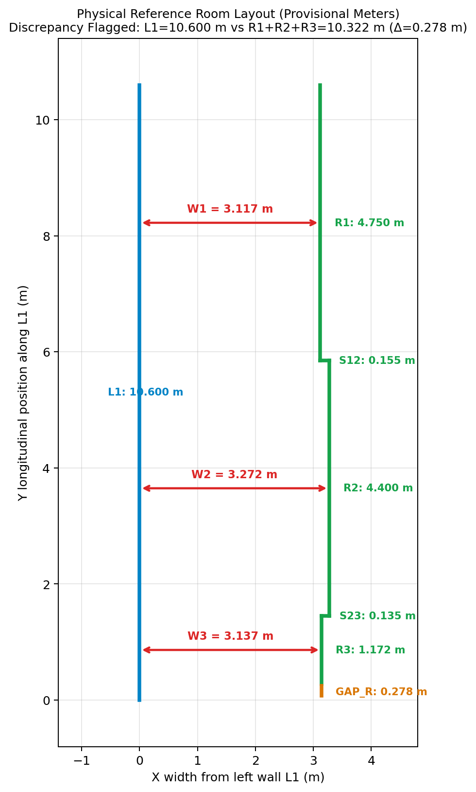
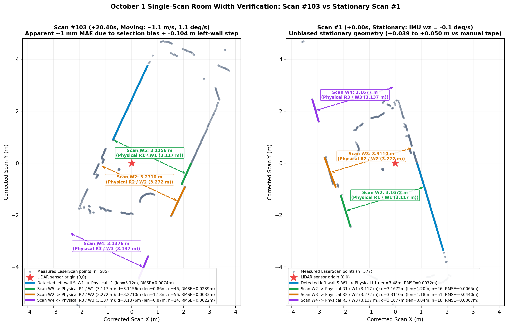
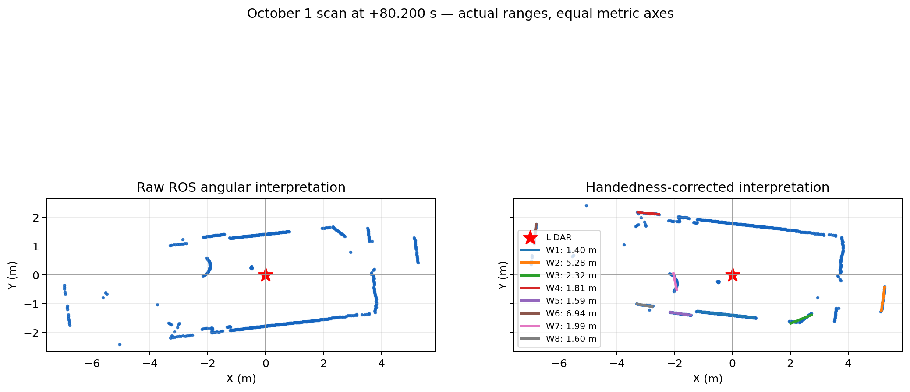
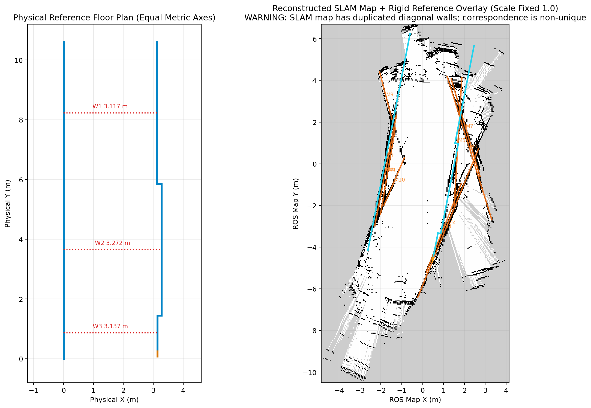

# October 1, 2026 LiDAR Geometry, TF, Odometry & Mapping Validation Report

**Related GitHub Issue:** [#6 — Check Lidar and mapping geometry](https://github.com/AlexisWiasmitinow/HorseShitBot/issues/6)
**Primary Recording:** `mapping_2026-10-01_14-36-31`
**Status:** First validation phase complete (offline geometry, scan handedness, rosbag audit, stationary-interval repeatability, physical room comparison, and interactive browser viewer).

---

## A. Objective

Validate HorseShitBot's LiDAR geometrical accuracy, angular orientation/handedness, static and dynamic TF configuration, rosbag recording completeness, and `slam_toolbox` occupancy-grid mapping accuracy using the October 1, 2026 room recordings, while strictly separating sensor-level behavior from TF, odometry, and SLAM errors.

---

## B. Dataset

Six October 1, 2026 rosbag directories were inventoried (`3` mapping bags and `3` perception bags). Two mapping bags were usable closed MCAP archives (`mapping_2026-10-01_14-36-31` and `mapping_2026-10-01_12-58-41`), whereas `mapping_2026-10-01_14-46-52` had a corrupted intermediate chunk (`bad_alloc` at message `12,188 / 38,579`).

All primary geometric and mapping validation uses the longest, cleanest recording:

- **Primary bag:** `mapping_2026-10-01_14-36-31` (`28 MB`, duration `160.341 s`)
- **Recorded topic counts (raw vs. deduplicated unique messages):**
  - `/scan` (`sensor_msgs/msg/LaserScan`): `1,604` raw $\rightarrow$ **`802` unique messages** (`2.0:1` exact duplicate ratio, `~5.0 Hz`)
  - `/odom` (`nav_msgs/msg/Odometry`): `16,036` raw $\rightarrow$ **`8,018` unique messages** (`2.0:1` exact duplicate ratio, `~50.0 Hz`)
  - `/tf` (`tf2_msgs/msg/TFMessage`, `odom -> base_link`): `16,036` raw $\rightarrow$ **`8,018` unique messages** (`2.0:1` exact duplicate ratio)
  - `/tf_static` (`tf2_msgs/msg/TFMessage`): **`0` messages** (topic declared in metadata, but no static transform was captured)
  - `/imu/data_raw`, `/imu/mag`, `/imu/temperature`: **`8,018` unique messages** each (`1.0:1`, no duplication)

---

## C. Physical Room Measurements

The room recorded on October 1, 2026 is a long, narrow space with a straight left-hand reference wall (`L1`) and a stepped right-hand wall (`R1`, `R2`, `R3`) with two changes in width (`S12`, `S23`). All confirmed dimensions are stored in `src/horseshitbot/config/room_measurements_oct1.yaml` and provisionally interpreted in **meters (`m`)**:

- **Overall left wall length (`L1`):** `10.600 m`
- **Horizontal room widths (perpendicular from left wall `L1` to stepped right wall):**
  - **Upper section width (`W1`, between `L1` and `R1`):** `3.117 m`
  - **Middle section width (`W2`, between `L1` and `R2`):** `3.272 m` (outward step `S12 = W2 - W1 = +0.155 m`)
  - **Lower section width (`W3`, between `L1` and `R3`):** `3.137 m` (inward step `S23 = W3 - W2 = -0.135 m`)
- **Right-hand wall longitudinal section lengths:**
  - **Upper section (`R1`):** `4.750 m`
  - **Middle section (`R2`):** `4.400 m`
  - **Lower section (`R3`):** `1.172 m`
- **Flagged longitudinal measurement discrepancy (`0.278 m`, preserved without modification):**
  \[
  R_1 + R_2 + R_3 = 4.750 + 4.400 + 1.172 = 10.322\text{ m} \quad\text{vs.}\quad L_1 = 10.600\text{ m} \quad (\Delta = 0.278\text{ m})
  \]
  Because of this `0.278 m` (`27.8 cm`) longitudinal difference, the floor-plan polygon is not closed artificially; the unresolved interval is explicitly modeled as `GAP_R` (`status: unresolved_discrepancy`) and flagged in the viewer.
- **Unassigned / excluded sketch annotations:**
  - Circled `0.7 m` (`status: unassigned`, `used_in_geometry: false`)
  - `327.3` on separate small sketch (`status: unclear_units_and_correspondence`, `used_in_geometry: false`)



---

## D. LiDAR Accuracy & Stationary-Interval Analysis

### 1. Stationary-Interval Results (Accounting for Temporal Scan Correlation)

Because consecutive `5 Hz` scans within a stationary pause are temporally correlated, each of the **9 qualified stationary intervals** (`462` stationary scans total, gated by step translation $\le 0.025\text{ m}$, heading change $\le 0.75^\circ$, ICP inlier ratio $\ge 0.90$, and registration RMSE $\le 0.05\text{ m}$) was analyzed as an independent pose unit ($k \le 9$), fitting total-least-squares (TLS) lines to the step-trimmed planar wall cores:

| Reference | Physical | LiDAR planar mean | Error | Independent intervals ($k$) | Within-interval SD | Between-interval SD | Wall-fit RMSE | LiDAR planar $1\sigma$ |
|---|---:|---:|---:|---:|---:|---:|---:|---:|
| **Upper `W1`** | `3.117 m` | **`3.1688 m`** | **`+0.0518 m`** (`+5.18 cm`, `+1.66%`) | `9` (`461` scans) | `±0.0020 m` | `±0.0096 m` | `±0.0058 m` | `±0.0069 m` |
| **Middle `W2`** | `3.272 m` | **`3.3145 m`** | **`+0.0425 m`** (`+4.25 cm`, `+1.30%`) | `5` (`237` scans) | `±0.0034 m` | `±0.0116 m` | `±0.0055 m` | `±0.0083 m` |
| **Lower `W3`** | `3.137 m` | **`3.1302 m`** | **`-0.0068 m`** (`-0.68 cm`, `-0.22%`) | `6` (`349` scans) | `±0.0062 m` | `±0.0270 m` | `±0.0101 m` | `±0.0162 m` |
| **Step `W2 - W1`** | `+0.155 m` | **`+0.1457 m`** | **`-0.0093 m`** (`-0.93 cm`) | `5` | `±0.0039 m` | `±0.0074 m` | `±0.0080 m` | `±0.0095 m` |

### 2. Per-Stationary-Interval Breakdown

| Interval | Scans (`n`) | Time (`s`) | `W1` (`3.117 m`) planar $\pm$ SD | `W2` (`3.272 m`) planar $\pm$ SD | `W3` (`3.137 m`) planar $\pm$ SD |
|---|---:|---:|---:|---:|---:|
| **Interval #1** | `#1–#17` (`17`) | `0.0–3.2 s` | `3.1725 ± 0.0020 m` (`+5.55 cm`) | `3.3116 ± 0.0009 m` (`+3.96 cm`) | `3.1200 ± 0.0062 m` (`-1.70 cm`) |
| **Interval #2** | `#47–#69` (`23`) | `9.2–13.6 s` | `3.1913 ± 0.0050 m` (`+7.43 cm`) | `3.3338 ± 0.0042 m` (`+6.18 cm`) | — |
| **Interval #3** | `#141–#195` (`55`) | `28.0–38.8 s` | `3.1693 ± 0.0010 m` (`+5.23 cm`) | `3.3138 ± 0.0021 m` (`+4.18 cm`) | — |
| **Interval #4** | `#207–#222` (`16`) | `41.2–44.2 s` | `3.1670 ± 0.0034 m` (`+5.00 cm`) | `3.3027 ± 0.0067 m` (`+3.07 cm`) | — |
| **Interval #5** | `#285–#420` (`136`) | `56.8–83.8 s` | `3.1624 ± 0.0006 m` (`+4.54 cm`) | `3.3105 ± 0.0029 m` (`+3.85 cm`) | `3.1494 ± 0.0040 m` (`+1.24 cm`) |
| **Interval #6** | `#421–#567` (`147`) | `84.0–113.2 s` | `3.1679 ± 0.0010 m` (`+5.09 cm`) | — | `3.1275 ± 0.0045 m` (`-0.95 cm`) |
| **Interval #7** | `#594–#612` (`19`) | `118.6–122.2 s` | `3.1558 ± 0.0012 m` (`+3.88 cm`) | — | `3.1698 ± 0.0088 m` (`+3.28 cm`) |
| **Interval #8** | `#742–#751` (`10`) | `148.2–150.0 s` | `3.1667 ± 0.0015 m` (`+4.97 cm`) | — | `3.1234 ± 0.0057 m` (`-1.36 cm`) |
| **Interval #9** | `#764–#802` (`39`) | `152.6–160.2 s` | `3.1664 ± 0.0022 m` (`+4.94 cm`) | — | `3.0909 ± 0.0081 m` (`-4.61 cm`) |

### 3. Why the Initial `~1 mm` Claim Was Rejected (Selection-Bias Audit)



An initial single-scan search reported `W1 = 3.1156 m`, `W2 = 3.2710 m`, and `W3 = 3.1376 m` (`MAE = 1.0 mm`) in **Scan #103 (`t = +20.40 s`)**. Independent verification proved that `1 mm` agreement was an artifact of two factors:
1. **Post-hoc selection bias:** The initial candidate search ranked all 802 scans by minimizing $|d_{\text{upper}} - 3.117| + |d_{\text{middle}} - 3.272| + |d_{\text{lower}} - 3.137|$, cherry-picking Scan #103 out of 802 scans. This ranking was replaced with a **target-free geometric quality score** based strictly on wall length and line-fitting RMSE.
2. **Non-stationary motion and left-wall recess contamination:** At `t = +20.40 s`, the robot was translating at `~1.08 m/s` and rotating (`max |IMU wz| = 19.8 deg/s`), and a `-0.104 m` (`-10.4 cm`) recess/doorway along the left wall entered segment `S1` (`bins 461..562`), pulling the fitted left-wall reference line inward by `~5 cm` relative to stationary scans.

### 4. Why the `~4–5 cm` Offset on `W1`/`W2` Does Not Justify Immediate Range Recalibration

Across all 48 target-free stepped-wall scans using untrimmed split-and-merge segmentation (`maximum_error = 0.055 m`), mean widths were `W1 = 3.1691 m` (`+5.21 cm`), `W2 = 3.3169 m` (`+4.49 cm`), and `W3 = 3.1870 m` (`+5.00 cm`). Decomposing the `~5 cm` offset across 9 candidate causes showed:
- **Segmentation corner-bridging accounts for `+1.8 cm` to `+3.0 cm` on `W2` and `W3`:** Trimming `±0.15 m` around the step transitions reduces wall-fit RMSE from `25–45 mm` to `4.3–8.0 mm` and brings planar `W3` (`3.1302 m` vs. `3.137 m`, **`-0.68 cm`**) and the `W2 - W1` step (`+0.1457 m` vs. `+0.155 m`, **`-0.93 cm`**) into `< 1 cm` agreement with physical measurements.
- **Multiplicative scale error is ruled out as the primary cause:** A `+1.5%` scale error would stretch all dimensions proportionally, contradicting the `-0.22%` (`-0.68 cm`) agreement on planar `W3` and `-0.93 cm` agreement on `W2 - W1`.
- **The remaining `+4.25 cm` (`W2`) to `+5.18 cm` (`W1`) planar offset is confounded between measurement height (`z ≈ 0.15 m` vs. floor baseboards) and additive two-way range offset:** The LiDAR scans horizontally at `z ≈ 0.15 m` above `base_link`. If the manual tape/laser measurements were taken at floor level between baseboards/plinths (`20–25 mm` thick per wall), the upper wall surface at `z = 0.15 m` is physically `40–50 mm` wider. Conversely, a `+22 to +25 mm` additive per-ray range offset would produce the same two-way wall separation increase. Without a direct one-way sensor-to-wall measurement and height-controlled physical measurements, range recalibration is **not justified**.

---

## E. Orientation & Angular Handedness



- **Historical driver bug (`CONFIRMED`):** In `src/horseshitbot/horseshitbot/nodes/lidar_node.py`, raw YDLidar T-MINI Plus angles (which increase **clockwise** around the optical core) are binned directly into a `sensor_msgs/msg/LaserScan` message that declares a positive `angle_increment = +2*pi / 720` (`+0.00872665 rad`), violating REP-103 counter-clockwise conventions.
- **Offline reflection transformation:** Because clockwise-vs-counter-clockwise ordering is a **2D reflection** across the sensor X-axis ($\theta_{\text{corrected}} = -\theta_{\text{recorded}}$), no 3D yaw rotation of `base_link -> laser` can fix it. In offline analysis and playback (`scripts/oct1_bag_player.py` and `scripts/validate_lidar_and_map.py`), the scan is reflected losslessly via:
  \[
  x = r \cos(\theta), \quad y = -r \sin(\theta) \qquad \Longleftrightarrow \qquad \text{corrected}[j] = \text{recorded}[(-j) \bmod N]
  \]
- **Preservation of range values:** This reflection preserves index `0` ($\theta = 0$) and every range measurement $r$ identically; it repairs angular handedness without altering LiDAR distances.
- **Production status:** The production driver (`lidar_node.py`) has **not** been modified in this branch; fixing the production driver is tracked as a separate change.

---

## F. TF & Rosbag Recording Completeness

- **Missing `/tf_static` (`FAIL`):** All October 1 bags contain `0` messages on `/tf_static`. The historical repository commit (`a2f72fd`) configured a static `base_link -> laser` transform with translation `(0.0, 0.0, 0.15) m` and RPY `(0.0, 0.0, 3.14159) rad`, which `scripts/oct1_bag_player.py` injects explicitly during isolated offline replay. Because `/tf_static` was not recorded, the exact physical mounting translation and yaw on October 1 remain **inconclusive** from bag data alone.
- **Duplicated streaming messages (`FAIL`):** Every unique `/scan`, `/odom`, and `/tf` message in `mapping_2026-10-01_14-36-31` appears **twice** (`2.0:1` duplicate ratio) with identical header timestamps and identical payloads. Offline tools deduplicate deterministically by `(topic, header.stamp)` (and transform stamps/frame IDs for `/tf`) and abort if any duplicate key ever carries a conflicting payload.

---

## G. Odometry & SLAM Reconstruction



- **Unreliable recorded wheel odometry:** Replaying `mapping_2026-10-01_14-36-31` with recorded `/odom` (`odom -> base_link`) into `slam_toolbox` (`online_async_launch.py`, resolution `0.05 m/pixel`) produces severe rotational smearing because open-loop wheel odometry overstates heading changes relative to both IMU gyro integration and LiDAR scan-to-scan motion.
- **ICP-assisted diagnostic mapping (`corrected_icp_odom`):** Replacing corrupted wheel odometry with pairwise trimmed-ICP scan registration (`median inlier ratio = 0.9517`, `median ICP RMSE = 0.0292 m`) allows `slam_toolbox` to produce a recognizable corridor/room occupancy grid (`180 x 344` cells at `0.05 m/pixel`).
- **Why the full-room SLAM map remains `UNRELIABLE` for metric calibration:** Pairwise scan-to-scan ICP without loop closure accumulates pose drift over the `160.3 s` trajectory (`15.14 m` path length, with individual motion steps up to `0.331 m` and `14.47°`). Consequently, the reconstructed occupancy grid contains duplicated diagonal wall layers (`M1..M18`, with `M1 = 9.104 m` and total longitudinal span `11.944 m` vs. physical `10.600 m`) and cannot be used as ground truth for sensor calibration.

---

## H. Validation Software & Interactive Browser Viewer

To inspect the October 1 recordings without requiring X11 or a live ROS 2 graph, this branch provides a standalone Python/HTML5 Canvas engineering tool (`scripts/view_lidar_room_web.py` and launcher `scripts/view_oct1_map.sh`):

- **Tab 1 — `LiDAR Scan`:**
  - Top-down metric visualization of all `802` deduplicated October 1 scans with LiDAR at `(0,0)` and equal X/Y scaling.
  - Animated playback using actual recorded timestamps (`Play`, `Pause`, timeline slider, `◀`/`▶` step buttons, `0.25×`–`2×` speed, `Raw` vs. `Corrected` toggle).
  - Gated multi-scan accumulation (`Single scan`, `Last 5 scans`, `Last 20 scans`, and `Selected stationary interval #1..#9`) that automatically falls back to a single scan whenever motion or registration quality violates safety gates.
  - Interactive wall-segment selection (`W1..W16`), perpendicular vs. endpoint distance calculation, **Recommended Scans for Measurement**, and **Show Validated Room Geometry**.
- **Tab 2 — `Room Map`:**
  - Renders the original `oct1_corrected_icp_odom.pgm` occupancy grid (`0.05 m/pixel`, origin `[-4.85, -10.5, 0]`) with ROS coordinate conversion, ICP trajectory overlay, interactive wall-to-wall measurement, and an explicit geometry reliability warning.
- **Tab 3 — `Real Room Comparison`:**
  - Side-by-side metric view of the **Physical Reference Floor Plan** (left, with the `0.278 m` longitudinal discrepancy flagged) and the **Reconstructed SLAM Map + Rigid Overlay** (right, translation + rotation only, scale locked to `1.0`), plus an inset of the **Actual Unreshaped LiDAR Scan**.
  - Interactive **Stationary-Interval & Uncertainty Diagnostic** selector (`All 9 stationary intervals` or `Interval #1..#9`) displaying physical width, LiDAR planar width, difference in `cm` and `%`, scan/interval counts, within/between-interval repeatability, decomposed $1\sigma$ uncertainty, and correspondence confidence.
  - One-click exports for `physical_reference_floor_plan.png`, `reference_vs_lidar_comparison.png`, `physical_vs_lidar_comparison.csv`, and `PHYSICAL_ROOM_VALIDATION_REPORT.md`.
- **Tab 4 — `Measurements`:**
  - Keeps single-scan and SLAM-map measurements strictly separate and exports annotated PNGs and CSVs with scan timestamps and wall IDs.

### Launching the Viewer

```bash
cd ~/HorseShitBot
bash scripts/view_oct1_map.sh
```

The server binds to `127.0.0.1:8765`. When connected via Cursor Remote-SSH or `ssh -L 8765:127.0.0.1:8765`, open:

```text
http://localhost:8765
```

---

## I. Summary of Conclusions (`PASS` / `FAIL` / `INCONCLUSIVE`)

- **PASS:**
  - Historical October 1 recording inventory, MCAP integrity verification, and SHA-256 synchronization verification.
  - Diagnosis of the clockwise scan-handedness bug and mathematical verification of the lossless reflection (`y = -r * sin(theta)`).
  - Identification and deterministic deduplication of `2:1` duplicated `/scan`, `/odom`, and `/tf` messages.
  - Direct single-scan and stationary-interval detection of the physical stepped right-hand wall (`+14.57 cm` LiDAR step vs. `+15.50 cm` physical `W2 - W1` step; `< 1 cm` agreement on step-trimmed planar `W3 = 3.1302 m` vs. `3.137 m`; `±2.0–3.4 mm` within-interval repeatability).
  - Standalone offline validation and browser visualization tooling (`scripts/view_lidar_room_web.py`, `scripts/validate_lidar_and_map.py`, `scripts/extract_oct1_lidar_web_data.py`).
- **FAIL:**
  - Historical `LaserScan` angular convention in `lidar_node.py` (clockwise bins published with positive `angle_increment`).
  - Missing `/tf_static` (`0` messages recorded in all October 1 bags).
  - `2:1` message duplication on `/scan`, `/odom`, and `/tf` in the October 1 bags.
  - Distorted `slam_toolbox` occupancy-grid map when using recorded wheel odometry (and residual multi-wall drift under unclosed pairwise ICP).
- **INCONCLUSIVE:**
  - **Exact LiDAR range calibration bias (`0 to +25 mm` per ray):** Whether the `+4.25 cm` (`W2`) to `+5.18 cm` (`W1`) planar width offset comes from floor-level baseboards/plinths vs. the `z ≈ 0.15 m` LiDAR scan plane, or from an additive range offset.
  - **Physical LiDAR mounting pose (`base_link -> laser`):** Cannot be proven from historical bags with `0` `/tf_static` messages.
  - **Full-room longitudinal map accuracy (`L1 = 10.600 m`):** Unconfirmed in single scans (due to occlusion) and unreliable in the SLAM map (due to rotational/translational drift and the `0.278 m` manual sketch discrepancy).

---

## J. Remaining Work & Follow-Up Protocol

1. **Measure all three room widths (`W1`, `W2`, `W3`) at actual LiDAR beam height (`z ≈ 0.15 m` above the floor)** at marked longitudinal stations using a laser distance meter (`3` repeated trials per station).
2. **Repeat the same three width measurements at floor/baseboard height** at the exact same longitudinal stations to quantify baseboard/plinth thickness directly.
3. **Perform independent one-way LiDAR distance checks at `1.000 m` and `2.500 m`:** Place the stationary robot facing a flat, plumb target wall with the LiDAR optical center at measured perpendicular distances of `1.000 m` and `2.500 m` (`z ≈ 0.15 m`) to isolate one-way range bias from wall-to-wall geometry.
4. **Verify physical LiDAR mounting orientation and translation** on the robot chassis (`base_link -> laser` X/Y/Z offset and forward `0°` index mark).
5. **Correct the production scan angular convention in `lidar_node.py`** in a dedicated, isolated pull request (and ensure `/tf_static` is recorded in future mapping bags).
6. **Investigate wheel odometry rotational scaling and SLAM drift** in a dedicated odometry/localization issue.
7. **Resolve the `0.278 m` room-length discrepancy** between `L1` (`10.600 m`) and `R1 + R2 + R3` (`10.322 m`).
